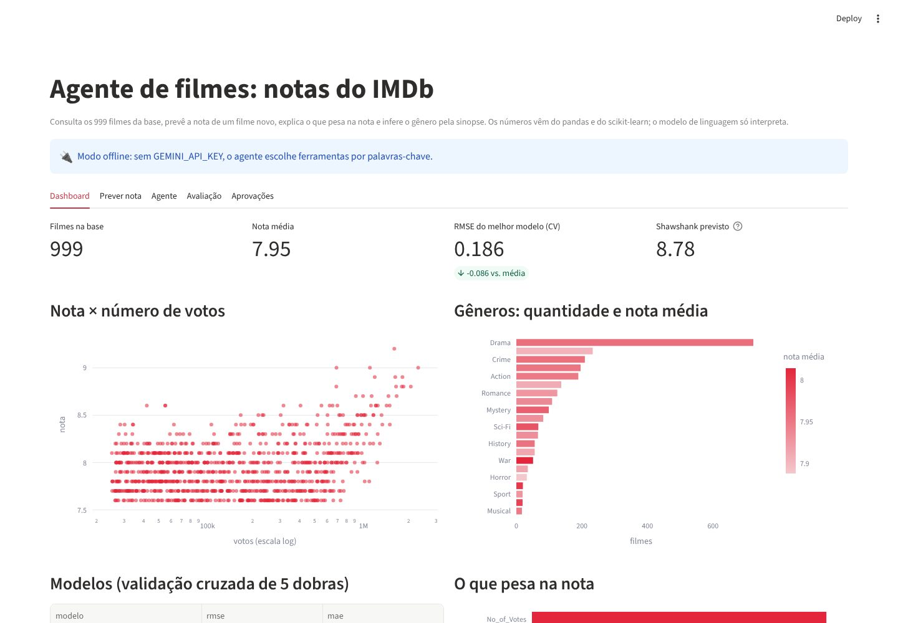
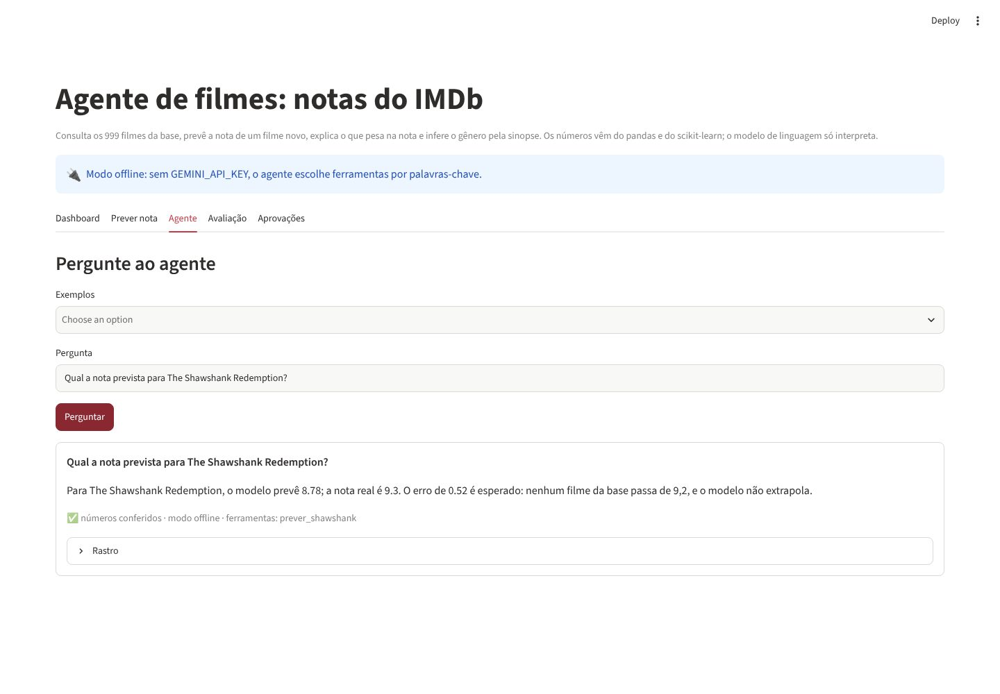

# Agente de filmes · notas do IMDb

Agente de IA que responde perguntas sobre os 999 filmes da base do IMDb, prevê a nota de um filme novo, explica o que mais pesa na nota, infere o gênero pela sinopse e recomenda filmes. A publicação de relatórios só acontece com aprovação humana.

O projeto começou como o desafio de ciência de dados do programa Lighthouse (Indicium): análise exploratória, previsão da nota de *The Shawshank Redemption* e perguntas de negócio. A análise original continua em [`docs/original/`](docs/original/).



## Como funciona
**O modelo interpreta, o código calcula e confere, a pessoa aprova.**

1. O Gemini lê a pergunta e escolhe as ferramentas, com saída em JSON Schema.
2. As consultas são filtros seguros do pandas, sem execução de texto livre, e os modelos são do scikit-learn. O modelo de linguagem não calcula nada.
3. O código confere se cada número da resposta saiu de uma ferramenta. Se algum não saiu, a resposta vira **revisar**.
4. `publicar_relatorio` é sensível e fica pendente até ser aprovado.

Sem `GEMINI_API_KEY`, o agente roda em modo offline, com roteamento por palavras-chave.

| Ferramenta | O que faz |
|---|---|
| `consultar_filmes` | Filtra por gênero, diretor, ator, ano, nota e duração; ordena por nota, votos, faturamento etc. |
| `estatisticas` | Médias e medianas de um gênero, diretor ou da base toda |
| `prever_nota` · `prever_shawshank` | Nota prevista para um filme novo, com um Pipeline salvo (pré-processamento + modelo) |
| `comparar_modelos` | RMSE em validação cruzada: média, linear, random forest e GBM |
| `explicar_nota` | Importância por permutação de cada variável |
| `genero_pela_sinopse` | TF-IDF + regressão logística um-contra-todos |
| `recomendar` | Recomendação pela nota ponderada por número de votos |
| `fatores_de_faturamento` | Correlações e faturamento mediano por gênero |
| `publicar_relatorio` | Sensível: exige aprovação |

## Resultados medidos
Validação cruzada de 5 dobras, nos 999 filmes:

| Modelo | RMSE | MAE |
|---|---|---|
| prever a média (linha de base) | 0,272 | 0,219 |
| regressão linear | 0,229 | 0,181 |
| **random forest** | **0,186** | **0,147** |
| GBM | 0,191 | 0,148 |

- **Shawshank:** previsão de **8,78**; a nota real é 9,3. A versão original reportava 9,30 exatos, mas o número não se reproduz: aquele pipeline só funcionava com o estado do notebook (o faturamento estava como texto no treino e como número na previsão, e o encoder dos gêneros não era salvo). O erro de 0,52 aqui é esperado, porque nenhum filme da base passa de 9,2 e árvores não extrapolam.
- **O que pesa na nota** (aumento do RMSE ao embaralhar cada coluna): número de votos +0,204, Meta Score +0,080, faturamento +0,064 e ano +0,060.
- **Gênero pela sinopse:** o gênero principal acerta em 67,3% dos filmes, em validação cruzada.

A avaliação contra gabarito (`python eval/run_eval.py`) acertou **21 de 21 casos**. As respostas esperadas são calculadas direto da base bruta, de forma independente das ferramentas: total de filmes do Nolan, filme de maior faturamento, duração mediana, nota média dos dramas e o ano de *Apollo 13* corrigido (a base traz "PG"). A avaliação também cobre as metas dos modelos, 10 perguntas de roteamento e a conferência de números.

Esse gabarito pegou um erro de verdade durante o desenvolvimento: as estatísticas eram calculadas só sobre os 50 primeiros filmes de cada consulta. Foi corrigido.

## Limites
- **Número de votos domina a previsão.** Ele só existe depois do lançamento, então a "previsão" serve para entender a nota, não para prever um filme antes de estrear. Sem os votos, o erro sobe.
- A base tem só os 1.000 filmes mais bem avaliados (notas entre 7,6 e 9,2). O modelo não sabe nada sobre filmes medianos ou ruins.
- O classificador de gênero usa sinopses em inglês e erra em um de cada três filmes no gênero principal.
- A escolha de ferramentas com o Gemini real ainda não foi medida. Para medir, rode o workflow manual `eval-gemini` com o secret `GEMINI_API_KEY`.

## Como rodar
```bash
pip install -e ".[dev]"
streamlit run app/streamlit_app.py   # dashboard, previsão e agente
python eval/run_eval.py              # avaliação contra gabarito
pytest -q                            # testes, sem rede
```



## Estrutura
```
data/dfbruto.csv        base do desafio (999 filmes)
src/filmeagent/
  agentcore.py          cliente Gemini, laço de ferramentas, conferência de números, aprovações
  core.py               limpeza, modelos, validação cruzada, classificador de gênero, consultas
  tools.py              ferramentas do agente e roteamento offline
app/streamlit_app.py    Dashboard · Prever nota · Agente · Avaliação · Aprovações
eval/run_eval.py        gabarito
docs/original/          notebook, script e respostas da versão original
```
